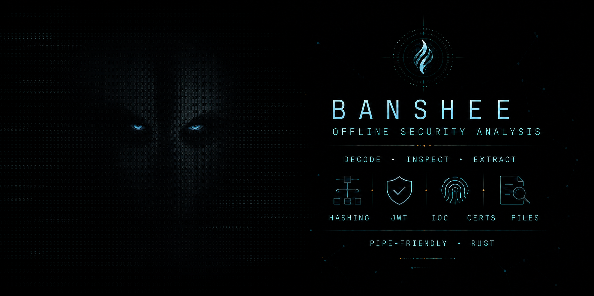

# Banshee

Banshee is an offline, pipe-friendly security analysis toolkit written in Rust.
It aims to bring common CyberChef-style transformations, JWT inspection, IOC
normalization, hashing, certificate inspection, timestamps, entropy analysis,
and regex utilities into one Linux terminal application.

> [!WARNING]
> **Alpha / early draft.** Banshee is under active development and its commands,
> output formats, rule syntax, and limits may change before a stable release.
> Treat its findings as analyst assistance—not as a final security verdict.

## Quick guide

Build the release binary, then pass Banshee a value, a file, or standard input:

```bash
cargo build --release

# Identify and unpack suspicious encoded content.
target/release/banshee whatis "aGVsbG8lMjB3b3JsZA=="

# Extract IOCs from a local log without sending it anywhere.
cat suspicious.log | target/release/banshee extract --defang

# Inspect a local file, archive, certificate, or executable.
target/release/banshee file inspect suspicious.zip
target/release/banshee cert inspect certificate.pem

# Emit structured output for scripts and pipelines.
target/release/banshee analyze --format json --file suspicious.bin
```

### What it can help with

- Decode layered Base64, hexadecimal, URL/HTML encoding, compression, and recipes.
- Extract and normalize URLs, domains, IP addresses, hashes, emails, and other IOCs.
- Analyze entropy, common encodings, JWTs, hashes, timestamps, certificates, archives, ELF, and PE files.
- Run local TOML rules, inspect regex patterns, and watch fresh log lines.
- Work offline with pipe-friendly human, JSON, JSONL, and CSV output.

## Capabilities (alpha)

The initial foundation includes the following commands:

- Detects Base64, hexadecimal, URL encoding, and HTML entities.
- Recursively decodes nested layers with depth and size limits.
- Detects Base64/Hex-wrapped gzip and zlib layers with a 16 MiB decompression limit.
- Flags JWTs, IPv4 addresses, domains, URLs, and common hash lengths.
- Measures Shannon entropy and gives an explainable triage score.
- Inspects JWT headers and payloads without claiming signature verification.
- Extracts and normalizes defanged URLs, domains, IPv4/IPv6, hashes, emails, and MAC addresses.
- Calculates and identifies MD5, NTLM, and SHA-family hashes; supports offline wordlists.
- Converts Unix timestamps (s/ms/us/ns) and RFC3339 date-times.
- Tests regular expressions and provides common security patterns.
- Inspects local PEM/DER X.509 certificates, fingerprints, key sizes, constraints, KU/EKU, and SANs.
- Parses PEM certificate chains and checks leaf-to-root names, signatures, CA authorization, and validity offline.
- Performs bounded bulk analysis of tokens, nested encodings, entropy, and IOCs.
- Reads raw binary files for analysis, hashing, and Base64/Base64URL/Hex encoding.
- Verifies HS, RS, PS, ES, and EdDSA JWT signatures with explicit algorithms.
- Encodes and decodes Base64, Base64URL, Base32, Ascii85, Hex, Binary, Octal, ROT13, Punycode/IDNA, URL, HTML, and Unicode escapes.
- Applies auditable, bounded transformation recipes including gzip and zlib layers.
- Lists ZIP/TAR contents without extraction, inspects gzip/XZ/BZip2 payloads, and flags unsafe archive paths.
- Parses basic ELF and PE architecture, bitness, entry-point, section, and subsystem metadata.
- Validates and scans with bounded local TOML rules using regex, literal, or wildcard-hex patterns.
- Follows appended log lines and analyzes fresh IOCs and encoded values without network access.
- Accepts a positional value, a file, or stdin.
- Supports human-readable, JSON, JSONL, and CSV output for extraction, bulk analysis, and log watching.

## Build

```bash
cargo build --release
```

The binary will be available at `target/release/banshee`.

On Linux, install it for the current user with:

```bash
sh scripts/install.sh
```

Use `--prefix /chosen/path` or set `PREFIX` to choose another installation root.

## Examples

```bash
banshee whatis "aGVsbG8lMjB3b3JsZA=="
echo "Njg2NTZjNmM2Zg==" | banshee whatis
banshee whatis --file suspicious.txt
banshee whatis --json "aGVsbG8="
banshee entropy "aGVsbG8gd29ybGQ="
banshee jwt inspect "eyJhbGciOiJIUzI1NiJ9.eyJzdWIiOiIxMjMifQ.signature"
cat access.log | banshee extract
cat access.log | banshee extract --url --domain --defang
banshee extract --hash --json --file suspicious.log
banshee hash calculate --algorithm sha256 "hello"
banshee hash identify d41d8cd98f00b204e9800998ecf8427e
banshee hash crack HASH --algorithm md5 --wordlist words.txt
banshee timestamp to-human 1704067200000
banshee timestamp to-unix "2024-01-01T00:00:00Z"
banshee regex test 'user=(\w+)' "user=alice"
banshee regex patterns
banshee cert inspect certificate.pem
banshee cert inspect certificate.der --json
banshee cert chain leaf-to-root-chain.pem
cat suspicious.log | banshee analyze --json
banshee analyze --file suspicious.bin
banshee encode base64 --file payload.bin
banshee jwt verify TOKEN --algorithm hs256 --secret "local-secret"
banshee jwt verify TOKEN --algorithm rs256 --key public.pem
banshee jwt verify TOKEN --algorithm es256 --key public.pem --audience banshee --issuer local
banshee encode base64 "hello"
echo 'aGVsbG8=' | banshee decode base64
banshee encode unicode "Banshee 👻"
banshee encode base32 "hello"
banshee encode punycode "bücher.de"
banshee decode binary "01101000 01101001"
banshee recipe 'base64|url' 'aGVsbG8lMjB3b3JsZA=='
banshee recipe 'base64|gzip|url' --file encoded-payload.txt
banshee recipe 'rot13|encode:base32' 'Uryyb'
banshee file inspect suspicious.zip
banshee file inspect package.tar.xz --json
banshee file inspect suspicious.exe
banshee rules validate examples/rules.toml
cat suspicious.log | banshee rules scan --rules examples/rules.toml
banshee rules scan --rules examples/rules.toml --file payload.bin --fail-on-findings
banshee watch /var/log/auth.log
banshee watch suspicious.log --from-start --once --json
banshee extract --format csv --file suspicious.log
banshee analyze --format jsonl --file suspicious.log
banshee extract --fail-on-findings --file suspicious.log
banshee extract --summary --sort count --file suspicious.log
banshee extract --allowlist known-safe.txt --denylist priority-iocs.txt --file suspicious.log
banshee --color always extract "https://evil.example 8.8.8.8"
banshee --no-color whatis "aGVsbG8="
banshee banner
banshee banner --compact
banshee banner --mask-only
banshee analyze --format json --output report.json --file suspicious.log
banshee banner --output banner.txt
banshee extract --quiet --fail-on-findings --file suspicious.log
banshee analyze --verbose --format jsonl --file suspicious.log
banshee completions bash > ~/.local/share/bash-completion/completions/banshee
banshee manpage > banshee.1
```

## Design principles

- Offline by default: analyzed values are never sent to a remote service.
- Pipe friendly: stdin and stable JSON output are first-class interfaces.
- Modular: detection, decoding, findings, input, and output are separate layers.
- Bounded: recursive decoding has configurable depth and fixed input-size limits.
- Recipes are local, limited to 32 steps and 64 MiB output; decompression is limited to 16 MiB.
- `file inspect` never extracts entries. Input is limited to 256 MiB, decompressed inspection payloads to 64 MiB, and archive listing is bounded by `--max-entries`.
- Rule files are limited to 1 MiB and 1,000 rules; scan input is limited to 64 MiB, compiled regex memory is bounded, and match reporting is capped per rule.
- `watch` processes completed appended lines; use `Ctrl+C` to stop continuous monitoring.
- `--fail-on-findings` gives scripts a status of `1` for discovered IOCs/analysis findings; operational errors return `2` and ordinary successful runs return `0`.
- Human output colors are automatic on an interactive terminal; use `--color always`, `--color never`, or `--no-color` to control them. Structured formats never include ANSI codes.
- `--output PATH` redirects all command output without shell syntax and refuses to replace an existing file unless `--force` is provided. Processing failures do not create a pending output file.
- `--quiet` suppresses normal output while preserving errors and exit statuses. `--verbose` writes timing and output-target diagnostics to stderr without echoing analyzed values, tokens, or secrets.
- IOC lists are local text files: blank lines and `#` comments are ignored, comparisons are case-insensitive, and `*` is supported as a wildcard. An allowlist suppresses known-safe values; a denylist limits output to matching values.

## Local rule format

Rules use TOML and remain entirely offline. `kind` may be `regex`, `literal`, or `hex`; hex patterns accept `??` as a one-byte wildcard. `severity` may be `info`, `low`, `medium`, `high`, or `critical`.

```toml
version = 1

[[rules]]
id = "powershell-encoded-command"
description = "PowerShell invocation using an encoded command"
severity = "high"
kind = "regex"
pattern = '(?i)powershell(?:\.exe)?\s+[^\r\n]{0,120}-enc\b'
tags = ["powershell", "execution"]

[[rules]]
id = "mz-marker"
kind = "hex"
pattern = "4D 5A ?? ??"
```

Use `min_matches = 2` to require repeated occurrences, or `case_insensitive = true` with regex and literal rules. Unknown TOML fields, duplicate IDs, invalid patterns, and unsupported schema versions are rejected by `rules validate` and `rules scan`.

## Security notes

- `jwt inspect` never claims signature verification.
- `jwt verify` requires an explicit expected algorithm to reduce algorithm-confusion risk.
- JWT `exp` and `nbf` claims are validated by default; `--ignore-time` is an explicit escape hatch.
- Prefer a key file where possible; command-line secrets may appear in process listings.
- Hash wordlist matching is local and never queries an online reverse-hash service.
- `cert chain` validates only the supplied chain; it does not establish trust against an OS trust store or query OCSP/CRL services.
- Archive inspection reports metadata and suspicious paths but deliberately does not extract files or execute payloads.
- Local rule matches are triage signals, not proof that a payload is malicious; review offsets and context before acting.
