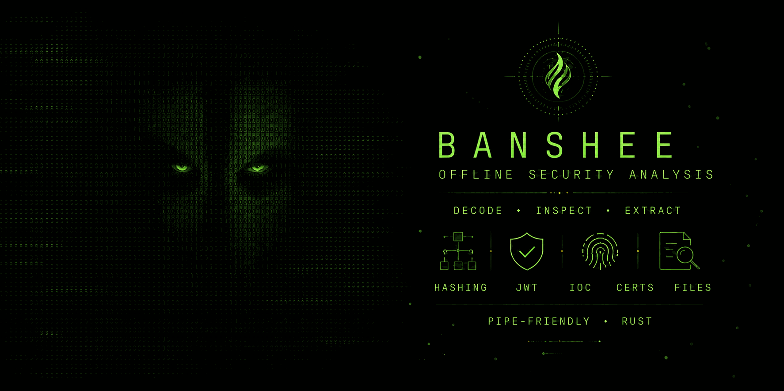

# Banshee

[English](README.md) · [Örnek komutlar](examples/usage.md) ·
[Adım adım vaka anlatımı](docs/WALKTHROUGH.md) · [Değişiklik günlüğü](CHANGELOG.md) ·
[Güvenlik](SECURITY.md)

Banshee, Rust ile yazılmış, çevrimdışı çalışan ve komut hatlarına (pipe)
uygun bir güvenlik analizi araç takımıdır. Şüpheli bir değeri, yerel bir
dosyayı ya da bir log kaydını açıklanabilir bulgulara ve paylaşılabilir
raporlara dönüştürür. İç içe kodlanmış içeriği çözer, göstergeleri (IOC)
normalleştirir, PE/ELF/Mach-O meta verilerini inceler, yerel kuralları uygular
ve sonuçları doğrulanabilir kanıt paketlerinde saklar. Analiz tamamen yerelde
yapılır; girdileriniz hiçbir yere yüklenmez.

Bu sayfa kısa bir Türkçe rehberdir. Tüm seçenekler, sınırlar ve ayrıntılar
için [İngilizce README](README.md) esas kaynaktır.

> [!WARNING]
> **Alfa sürüm.** Banshee aktif olarak geliştiriliyor. Eksik, hatalı ya da
> yanlış davranışlar görülebilir; komutlar, çıktı biçimleri ve kural
> sözdizimi kararlı sürümden önce değişebilir. Bulgular analiste yardımcı
> sinyallerdir, kesin bir güvenlik hükmü değildir.

## Ne işe yarar?

| Görev | Komutlar | Sonuç |
| --- | --- | --- |
| Bilinmeyen bir değeri anlamak | `whatis`, `entropy`, `recipe` | Kodlama katmanları ve açıklamalı sinyaller |
| Loglardan gösterge toplamak | `extract`, `analyze`, `watch` | Normalleştirilmiş IOC'ler, bağlam satırları, maskelenmiş gizli bilgi adayları |
| Yerel dosyaları incelemek | `file inspect`, `strings`, `hexdump`, `jwt`, `cert`, `hash` | Arşiv, disk imajı, çalıştırılabilir dosya, Office, PDF, LNK, e-posta, betik ve EVTX olay logu yapısı |
| Tespit mantığı uygulamak | `rules validate`, `rules scan`, `scan` | Yerel kural eşleşmeleri ve dosya bazında durumlar |
| Rapor hazırlamak | `report` | Metin, JSON, Markdown, SARIF veya bağımsız HTML |
| Sonuçları saklamak ve karşılaştırmak | `evidence`, `diff` | Hash kontrollü kanıt paketleri ve rapor farkları |
| Göstergeleri paylaşmak | `export` | STIX 2.1, MISP olay JSON'u veya CSV |
| Etkileşimli çalışmak | `banshee`, `shell` | Kategorili yardım ve Tab tamamlamalı `banshee>` konsolu |
| Kurulumu kontrol etmek | `doctor` | Kodekler, gömülü veriler, PATH ve geçici dizin raporu |

Her komutun biçimleri ve sınırları için `banshee <komut> --help` kullanın.

## Kurulum

### Hazır paketler

[Banshee v0.3.1](https://github.com/dRafaleD/Banshee/releases/tag/v0.3.1)
Windows x86_64, Linux x86_64/ARM64 ve macOS Intel/Apple Silicon için alfa ön
sürüm olarak yayımlandı. Arşivi ve yanındaki `.sha256` dosyasını aynı dizine
indirin, açmadan önce sağlama toplamını kontrol edin:

```powershell
$archive = 'banshee-0.3.1-x86_64-pc-windows-msvc.zip'
$expected = ((Get-Content "$archive.sha256").Trim() -split '\s+')[0]
if ((Get-FileHash $archive -Algorithm SHA256).Hash -ine $expected) { throw 'Checksum mismatch' }
Expand-Archive $archive
.\banshee-0.3.1-x86_64-pc-windows-msvc\banshee.exe doctor
```

```bash
sha256sum --check banshee-0.3.1-x86_64-unknown-linux-gnu.tar.gz.sha256
tar -xzf banshee-0.3.1-x86_64-unknown-linux-gnu.tar.gz
./banshee-0.3.1-x86_64-unknown-linux-gnu/banshee doctor
```

Arşivin kim tarafından derlendiğini `gh attestation verify ARŞİV --repo
dRafaleD/Banshee` ile doğrulayabilirsiniz. Çıkan `banshee` dosyasını
`PATH`'e kendiniz eklemeniz gerekir.

### Kaynaktan derleme

Rust 1.88 veya daha yenisi gerekir. Windows'ta Visual Studio C++ derleme
araçları, Linux'ta `build-essential pkg-config liblzma-dev` paketleri
kurulu olmalıdır. Banshee alfa döneminde crates.io'da yayımlanmadığı için
`cargo install banshee` henüz çalışmaz.

```bash
git clone https://github.com/dRafaleD/Banshee.git
cd Banshee
cargo build --release --locked
```

Ayrıntılar: [kurulum rehberi](docs/INSTALLATION.md) (İngilizce).

## Hızlı başlangıç

### Türkçe arayüz

`--lang tr` seçeneği ya da `BANSHEE_LANG=tr` ortam değişkeni insan okunur
metinleri Türkçe yapar: `banshee --lang tr --help` kategorili menüyü,
seçenekleri ve hızlı başlangıcı Türkçe gösterir. JSON, CSV, Markdown, HTML,
STIX ve MISP çıktıları, betikler ve paylaşılan raporlar dile göre
değişmesin diye İngilizce kalır.

### Etkileşimli konsol

`banshee` argümansız çalıştırıldığında bir başlangıç ekranı ve ardından
`banshee>` konsolu açılır. Konsolda komutları `banshee` öneki olmadan
yazarsınız.

- `tr` (veya `lang tr`) konsolu Türkçeye, `en` İngilizceye çevirir.
- `help` komutları kategorilere göre listeler; `help <komut>` ayrıntı verir.
- Tab komutları, alt komutları, seçenekleri ve dosya yollarını tamamlar.
  Geçmiş yalnızca bellekte tutulur, diske yazılmaz.
- `open ornek.bin` bir dosyayı oturum boyunca açık tutar; sonra `@` ile ona
  başvurabilir (`report @ --format json`) ya da `report`, `whatis`, `scan`
  gibi komutları tek başına yazabilirsiniz.
- `history`, `!N`, `save <dosya>` ve `run <dosya>` komut dizilerini kaydedip
  başka bir örnekte tekrar çalıştırmayı sağlar.

### İlk komutlar

```bash
# Kodlanmış bir değeri katman katman çöz (Base64, Base32, hex, URL, gzip...).
banshee whatis "aGVsbG8lMjB3b3JsZA=="

# Bir logdan IOC çıkar, paylaşmaya uygun biçimde etkisizleştir (defang).
banshee extract --defang --file supheli.log

# Olası parolaları ve anahtarları değerleri maskelenmiş olarak bul.
banshee extract --secret --context 2 --file uygulama.log

# Bir dosyayı, arşivi, sertifikayı veya olay logunu incele.
banshee file inspect fatura.eml
banshee file inspect Security.evtx

# Hash'ler, dosya yapısı, entropi, IOC'ler ve kural eşleşmelerinden rapor üret.
banshee report supheli.bin --builtin-rules --format markdown --output rapor.md

# Bir dizini sınırlı kaynak kullanımıyla tara.
banshee scan ./ornekler --recursive --builtin-rules --format jsonl

# Kanıt paketi oluştur, sonra doğrula.
banshee --output vaka-1 evidence create supheli.bin --builtin-rules
banshee evidence verify vaka-1

# İki raporu veya kanıt paketini karşılaştır.
banshee diff vaka-1 vaka-2

# Göstergeleri tehdit istihbaratı platformlarıyla paylaş (hüküm veya gizli değer içermez).
banshee export vaka-1 --format stix --output gozlemler.stix.json
```

Bu komutların uçtan uca kullanımı için [vaka anlatımına](docs/WALKTHROUGH.md)
bakın: şüpheli bir e-postadan başlayıp benzer alan adı tespiti, gizli bir
URL'nin çözülmesi, rapor, kanıt paketi, karşılaştırma ve STIX dışa aktarımına
kadar gider.

## Öne çıkan yetenekler

- **Kod çözme:** İç içe Base64, Base32, hex, URL/HTML kodlaması, Unicode
  kaçışları, gzip/zlib ve Base64/hex içindeki basit XOR katmanları.
  `anahtar=değer` biçimindeki token'ların değerleri de çözülür.
- **IOC çıkarımı:** URL, alan adı, IPv4/IPv6, hash, e-posta ve MAC adresleri;
  etkisizleştirilmiş (`hxxp`, `[.]`) yazımları da tanır. Uluslararası alan
  adları Punycode olarak kaydedilir; Latin harflerini Kiril, Yunan veya
  Ermeni harfleriyle karıştıran ya da başka bir ASCII adı gibi okunan alan
  adları "possible homoglyph" olarak işaretlenir.
- **Dosya inceleme:** ZIP/TAR/ISO/CAB arşivleri, PE/ELF/Mach-O ve .NET
  çalıştırılabilir dosyaları, Authenticode imzalayanları, Office/RTF/PDF/LNK
  belgeleri, e-postalar, betikler ve Windows olay logları (EVTX: olay
  kimlikleri, sağlayıcılar, zaman aralığı, log temizleme olayları, CRC ve
  kayıt numarası boşlukları). Hiçbir örnek çalıştırılmaz veya arşivden
  çıkarılmaz.
- **Bulanık hash'ler:** ssdeep ve TLSH. TLSH özetleri referans uygulamayla
  aynıdır, diğer araçların özetleriyle karşılaştırılabilir.
- **Kurallar:** Yerel TOML kuralları, YARA'ya dışa aktarma ve YARA'dan içe
  aktarma.

### Gömülü kural paketi

`--builtin-rules`, Banshee'nin içine gömülü yaklaşık 35 kurallık bir
başlangıç paketini uygular; böylece `rules scan`, `report`, `scan` ve
`evidence create` bir kural dosyası olmadan da çalışır. Paket PowerShell
indirme kalıplarını, LOLBin kullanımını (certutil, mshta, regsvr32,
rundll32, bitsadmin), gölge kopya silme gibi fidye yazılımı hazırlıklarını,
Defender'ı devre dışı bırakmayı, Mimikatz ve LSASS dökümünü, VBA/VBScript/
JScript yürütmeyi, PHP/JSP/ASPX web kabuklarını, Unix ters kabuklarını ve
webhook, bot API, paste sitesi ve onion adreslerini kapsar. Her kuralın bir
kategorisi, güven düzeyi ve ATT&CK kimlikleri vardır.

```bash
banshee rules builtin --list            # kural kimlikleri, önem dereceleri, açıklamalar
banshee rules builtin > kurallarim.toml # kendi paketinize başlangıç
```

Bu komutların bazılarını sistem yöneticileri ve kurulum programları da
meşru olarak kullanır; özellikle düşük güvenli eşleşmeleri gözden geçirin.

## Sorumlu kullanım

- Arşiv ve çalıştırılabilir dosya incelemesi örnekleri asla çalıştırmaz veya
  dosya çıkarmaz.
- Kural eşleşmeleri ve gizli bilgi adayları sinyaldir; harekete geçmeden önce
  bağlamı inceleyin.
- Kanıt paketleri varsayılan olarak kaynak örneği içermez; `--include-sample`
  açık bir tercihtir.
- Banshee savunma amaçlı araştırma, eğitim, olay müdahalesi ve sahibi
  olduğunuz ya da açıkça yetkilendirildiğiniz sistemlerin analizi içindir.
  Yazılım "olduğu gibi" sunulur; kullanımınızdan siz sorumlusunuz.

Ayrıntılı güvenlik notları için İngilizce README'deki
[Security & responsible use](README.md#security--responsible-use) bölümüne,
güvenlik açığı bildirimi için [güvenlik politikasına](SECURITY.md) bakın.

## Lisans

[MIT](LICENSE)
